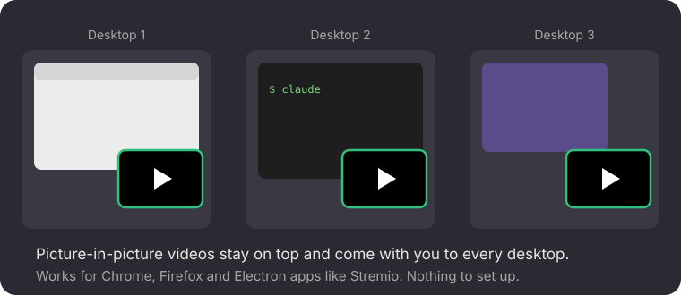

<p align="center"></p>

<h1 align="center">PiP Everywhere</h1>

<p align="center">Picture-in-picture videos on GNOME stay on top of other windows,<br>
follow you to every desktop, and get GNOME's window menu on right-click.</p>

<p align="center"></p>

## The problem

On GNOME with Wayland, a picture-in-picture window from Chrome, Firefox or an Electron app
(Stremio, for example) is treated like any other window: other windows cover it, and it stays
behind when you switch desktops. Apps can't ask for "always on top" or "on all desktops" on
Wayland, so the browser's own setting doesn't help.

## What it does

- **On top, on every desktop.** As soon as a picture-in-picture window appears, it's kept
  **always on top** and **on all desktops**. It appears at once, without GNOME's zoom-in.
- **Right-click menu.** Right-clicking the video opens GNOME's window menu, like Firefox's
  picture-in-picture does: turn *Always on Top* or *Always on Visible Workspace* off, move,
  resize, take a screenshot or close it. Chrome and Electron apps don't offer one themselves.

It
recognizes Chromium and Electron windows ("Picture in picture") and Firefox's
("Picture-in-Picture"). Other windows are never touched, and turning the extension off undoes
it for open windows.

For TikTok in Firefox, [TikTok PiP](https://github.com/aimanelahssini/firefox-tiktok-pip) adds
picture-in-picture that pops out by itself when you leave the tab, and ↑ ↓ to switch videos.

## Install

Needs GNOME Shell 50.

```bash
git clone https://github.com/aimanelahssini/gnome-pip-everywhere
cd gnome-pip-everywhere
./install.sh
```

Log out and back in once so GNOME loads it.

## Uninstall

```bash
gnome-extensions disable pip-everywhere@aimanelahssini
rm -rf ~/.local/share/gnome-shell/extensions/pip-everywhere@aimanelahssini
```

## License

MIT
